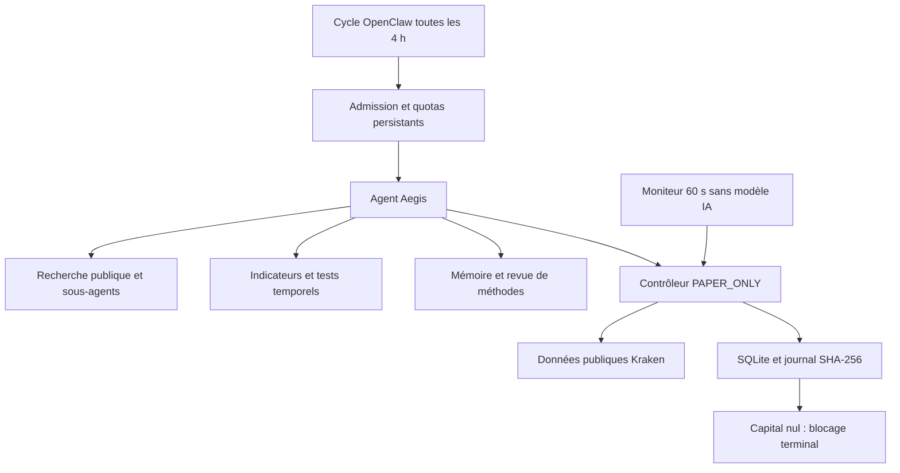

# Architecture

## Frontières

Le modèle choisit des hypothèses et des expériences simulées. Le contrôleur détient le registre, récupère les prix indépendamment et applique les limites. Aucun connecteur d'exécution réelle n'existe. Les sous-agents partagent la mémoire mais ne peuvent pas ouvrir de positions. Seule la session principale ou une racine cron isolée détient les droits du coordinateur; les sessions secondaires, y compris les tâches visibles de type dashboard, restent dédiées à la recherche. Les nouvelles délégations sont forcées en mode interne. Les skills sont des procédures documentaires; leur promotion n'exécute aucun code.

Les écritures financières se font dans une transaction SQLite `BEGIN IMMEDIATE`, avec WAL, synchronous FULL et clé d'idempotence. Le capital est en centimes; les débits sont arrondis vers le haut et les crédits vers le bas. Les quantités suivent la précision de lot publique. La valorisation utilise le bid, moins slippage et frais de sortie. Les soldes à prix périmé sont explicitement signalés.

L'initialisation écrit une identité externe au workspace. Une identité sans base bloque la réinitialisation. À zéro, un tombstone et l'état closed empêchent tout nouveau tour Aegis; aucun bouton ne réinitialise le capital. L'intégrité par empreinte permet de détecter une modification incohérente des événements, de l'état ou des notes, sans constituer une signature externe contre un administrateur malveillant. Les archives et l'installation OpenClaw ne sont pas détruites.

Le moniteur ne consomme pas de modèle : il contrôle les positions chaque minute, tente les sorties stop/cible/échéance et conserve les erreurs. Il n'invente pas de remplissage lors d'une panne. Un redémarrage reprend le registre existant. Les essais historiques séparent sélection et holdout, mais la fenêtre récente limitée de bougies et la modélisation simplifiée interdisent de conclure à un avantage durable.

## Évolution possible

Ajouter des sources publiques officielles, enrichir les corpus, importer un historique plus long, instrumenter les factures du fournisseur IA et valider de nouvelles méthodes en avant. Toute évolution des droits, installations de logiciel ou connexion financière passe par le propriétaire. Cette version ne fournit pas d'exécution réelle, même avec une option de configuration.
