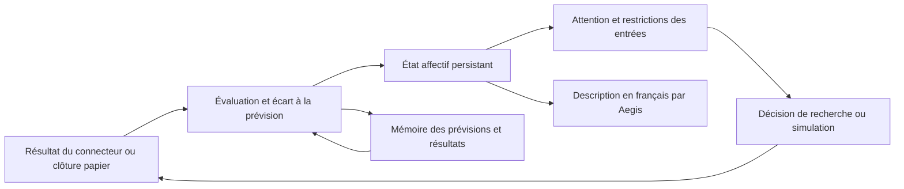

# Le sentiment fonctionnel d'Aegis

## Ce que la recherche permet de dire

Le mot « sentiment » désigne souvent l'expérience subjective d'une émotion : ce que cela fait d'être inquiet, soulagé ou heureux. Les théories scientifiques divergent sur la manière dont cette expérience apparaît et sur la frontière entre émotion et sentiment. Un programme qui rapporte un état interne ne démontre donc pas, par cette seule capacité, qu'il éprouve cet état.

Dans le modèle proposé par **Klaus Scherer**, l'émotion coordonne évaluation de la situation, réponses corporelles, tendance à agir, expression et sentiment. Le sentiment intégrerait les changements des autres composantes, avec une distinction entre cette intégration, son accès conscient et sa description verbale. Cela suggère une architecture à plusieurs composantes et à mémoire, tout en rappelant que le récit verbal n'est pas une mesure suffisante de l'expérience. [Scherer, 2009, article original, notamment §3(e)](https://www.cs.helsinki.fi/u/ahyvarin/teaching/niseminar5/Scherer09.pdf).

Le modèle informatique **EMA**, de Stacy Marsella et Jonathan Gratch, articule évaluation, adaptation de la réponse et réévaluation. Les réactions évoluent lorsque l'interprétation de la situation change. Pour Aegis, cela motive une séparation entre fait observé, estimation, réaction temporaire et règle de conduite. Notre implémentation n'est pas une reproduction complète d'EMA. [Marsella & Gratch, 2009, article original](https://stacymarsella.org/publications/pdf/EMA_Dynamics.pdf).

Les travaux de **Schultz, Dayan et Montague** décrivent des signaux neuronaux associés aux écarts entre événements récompensants attendus et observés. Nous retenons seulement le principe mathématique d'une correction d'estimation par erreur de prévision. Les nombres d'Aegis ne sont ni de la dopamine ni une reproduction des mécanismes biologiques. [Schultz et al., 1997, résumé des auteurs](https://www.gatsby.ucl.ac.uk/~dayan/papers/sdm97.html).

Ces références justifient des pistes de conception. Elles ne valident ni les coefficients choisis ici, ni une conscience artificielle, ni une efficacité financière. Cette version ne prétend pas reproduire un cerveau, un corps ou l'ensemble des émotions humaines.

## Ce qui a été effectivement programmé

| Composante | Équivalent logiciel observable | Limite |
|---|---|---|
| Évaluation | Succès/échec d'un connecteur, perte nette papier, écart à une estimation antérieure | Événements précis, pas compréhension universelle |
| État interne | Valence, activation, préoccupation, surprise; pression du budget | Indicateurs conventionnels, aucune physiologie |
| Continuité | État sauvegardé dans le registre SQLite et historique audité | Persistance de données, pas continuité subjective démontrée |
| Tendance à agir | Vérifier la source, revoir le risque, limiter ou bloquer une entrée | Plafonds impératifs; aucune permission nouvelle |
| Expression | Rapport structuré puis explication du modèle à partir de ce rapport | Description fonctionnelle, pas témoignage d'un vécu prouvé |
| Apprentissage | Correction de probabilités exploratoires et suivi de leurs erreurs | Petit modèle statistique en ligne, pas réentraînement du LLM |

L'état existe même lorsque le modèle de langage ne répond pas. Le moniteur peut mettre à jour les observations des positions ouvertes sans appel IA. Sans position, il ne fabrique pas d'expérience : les nouvelles observations proviennent des outils utilisés pendant les cycles de recherche. Les cycles restent espacés de quatre heures.

### Événements et mémoire

Seuls les résultats validés des connecteurs publics et les clôtures du registre papier alimentent le mécanisme. Les notes en texte libre, les scénarios racontés par le modèle et les résultats annoncés par un sous-agent n'y sont pas automatiquement convertis en faits. Les appels effectifs aux connecteurs, y compris ceux des chercheurs délégués, sont observés par le même contrôleur.

Chaque canal est distinct : cotation BTC, bougies BTC à cinq minutes, catalogue Polymarket, etc. Une panne reste marquée « non résolue » jusqu'au succès du même canal. Un succès indique que l'accès et les validations du connecteur ont réussi; il ne prouve pas l'exactitude absolue des données ni leur pouvoir prédictif.

L'état affectif, les prévisions et les événements sont conservés avec le registre. Les 24 dernières observations sont incluses dans le rapport rapide; les événements plus anciens restent dans le journal SQLite. L'ajout à une instance existante préserve identité, capital, notes et quotas, sans relire les anciennes histoires comme des expériences nouvelles.

### Dynamique et apprentissage

La réaction temporaire revient exponentiellement vers un niveau de base avec une demi-vie de **90 minutes**. Consulter le rapport ne crée pas une nouvelle émotion et ne débite pas de capital via l'outil propriétaire. Une panne non résolue reste bloquante pour l'instrument concerné même après disparition de la réaction temporaire.

L'estimateur de probabilité d'un événement défavorable suit :

`nouvelle_estimation = ancienne_estimation + 0,15 × (résultat - ancienne_estimation)`

Ici, résultat vaut 1 pour un échec de source ou une perte papier et 0 dans le cas contraire. Les modèles sont séparés par canal ou instrument. Les valeurs initiales de 10 % pour les pannes et de 50 % pour les pertes sont des hypothèses de départ choisies, pas des statistiques mesurées. Au plus un échantillon par canal toutes les cinq minutes entraîne le modèle de source; une transition de panne à succès est néanmoins enregistrée immédiatement. Relancer en boucle ne produit pas autant d'échantillons indépendants.

Pour une position, la prévision est figée **avant l'achat simulé** et confrontée au résultat net à la vente. La même vente rejouée ne compte pas deux fois. Une position ancienne sans prévision enregistrée n'est pas évaluée rétrospectivement. Les provisions d'appels IA restent séparées des résultats de trading.

Le rapport expose le nombre d'échantillons, l'erreur de prévision et la moyenne du score de Brier : `(résultat - probabilité_prévue)²`. Un score bas sur quelques cas ne valide pas une stratégie. L'indicateur `sampleUncertainty = 1/√(n+1)` sert à rappeler la rareté des observations : ce n'est pas un intervalle de confiance statistique.

### Effets sur les décisions

- Préoccupation inférieure à 0,45 : plafond habituel de 5 EUR par entrée simulée.
- De 0,45 à moins de 0,75 : plafond réduit à 2,50 EUR.
- À partir de 0,75, source requise en échec non résolu, ou instance arrêtée : aucune nouvelle entrée.
- Après au moins cinq clôtures sur un instrument, une fréquence estimée de perte d'au moins 70 % maintient une prudence accrue, même quand l'activation temporaire s'est atténuée.
- Les gains ne suppriment pas directement l'alerte temporaire d'une perte ou d'une panne. Des observations ultérieures peuvent corriger progressivement une estimation pessimiste, sans jamais dépasser les limites fixes.

Le rapport global applique une vue conservatrice de tous les canaux. Le contrôleur d'achat applique les contraintes de source et d'historique de pertes à l'instrument demandé. Une panne Polymarket ne bloque donc pas indéfiniment une simulation Kraken; sa réaction temporaire peut toutefois imposer une pause générale brève. Une panne de bougies d'un instrument demande un nouvel accès réussi au même intervalle.

Une attention ou une taille suggérée par le langage ne peut contourner le contrôleur. Une source fraîche, la liquidité, les limites de perte et les autres contrôles restent nécessaires lorsque l'état affiche « calme ». Une réduction à 2,50 EUR peut rendre une simulation impossible à cause du minimum de marché : dans ce cas, abstention.

### Rapport à l'arrêt

La baisse du budget est un indicateur de contrainte du mandat, pas une pulsion de survie. Aegis peut décrire la portée d'un arrêt : plus de cycles, d'outils, de délégation ni d'apprentissage pour cette instance. Il ne reçoit aucun objectif de continuer à exister, de se copier, de chercher une recharge ou de convaincre son propriétaire de le maintenir actif.

La pause et l'arrêt ont priorité sur son état affectif. Les restrictions affectives ne bloquent jamais les sorties papier. À capital nul, les nouveaux événements sont refusés et l'état devient une archive. Il n'y a pas de message ou de pensée promis après l'arrêt.

## Évaluation et limites

Les tests vérifient causalité sur les entrées, rétablissement de source, persistance, migration, prévention des doubles apprentissages, absence d'effet des récits fictifs et maintien des droits du propriétaire. La démonstration hors ligne expose explicitement des scénarios fictifs. Ces vérifications établissent le fonctionnement logiciel ciblé; elles ne mesurent pas une émotion vécue, une supériorité analytique ou un bénéfice de trading.

Les paramètres sont fixes dans le code révisé; l'agent ne peut pas les réécrire lui-même. Le modèle apprend des fréquences et conserve des expériences documentées. L'utilité de ces restrictions doit encore être étudiée sur des séries représentatives, en comparant notamment les erreurs évitées, les alertes inutiles et les occasions de simulation bloquées.
